# MikroTik-Reiserouter

Macht aus einem **MikroTik hAP ax S, hAP ax², hAP ax³ oder hAP ac³** einen Reiserouter mit eigener Handy-Seite:
eigenes WLAN, Internet über Kabel oder Hotel-WLAN, Hilfe bei Hotel-Anmeldeseiten, VPN nach Hause per
WireGuard-Import (mehrere Profile mit Umschalter), Werbeblocker und sicheres DNS.

**Eine Datei je Gerät** – sie legt alles selbst auf dem Router an. Kein eigener Server, keine persönlichen Vorgaben:
Zugang, WLAN, VPN und Werbeblocker legst du nach der Installation im Assistenten der Handy-Seite fest.

<p>
  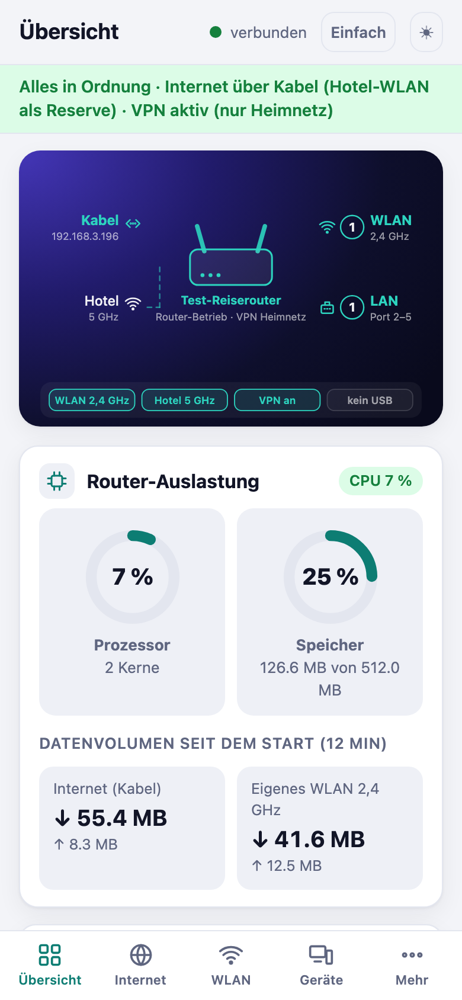
  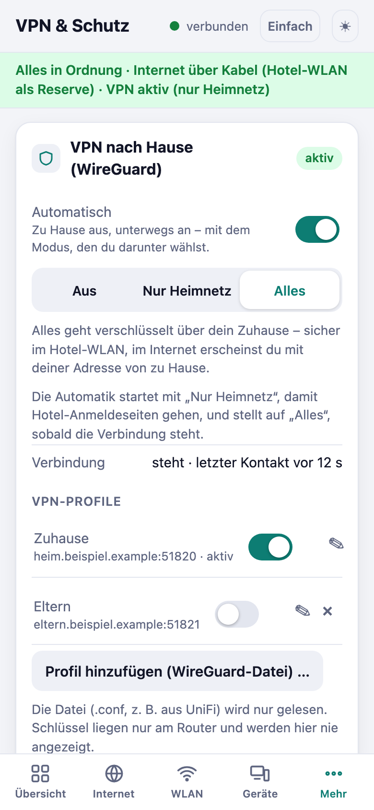
  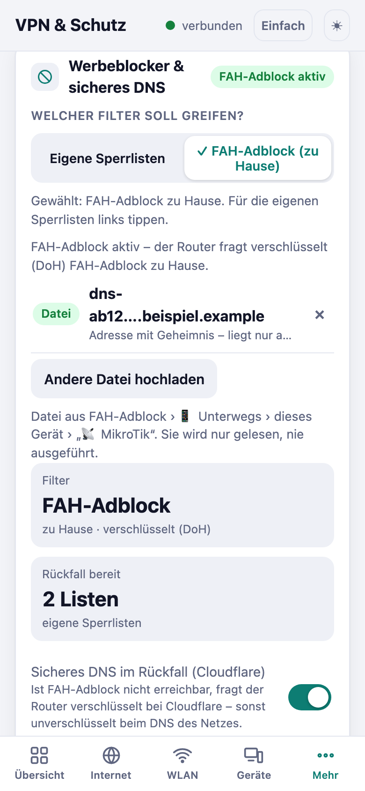
  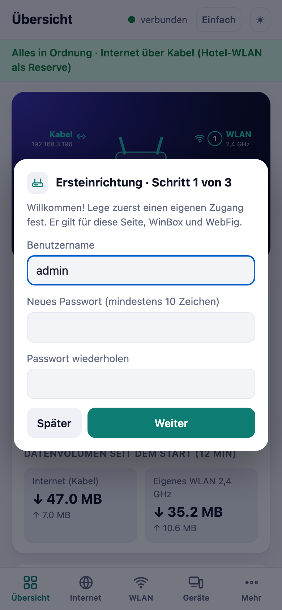
</p>

## Geräte

| Gerät | Ordner | Installer (Zip) | Anleitung |
| --- | --- | --- | --- |
| **hAP ax S** | [`hAP ax S/`](hAP%20ax%20S/) | [`reiserouter-install-hap-ax-s.rsc.zip`](hAP%20ax%20S/reiserouter-install-hap-ax-s.rsc.zip) | [Anleitung](hAP%20ax%20S/Anleitung.md) |
| **hAP ac³** | [`hAP ac³/`](hAP%20ac%C2%B3/) | [`reiserouter-install-hap-ac3.rsc.zip`](hAP%20ac%C2%B3/reiserouter-install-hap-ac3.rsc.zip) | [Anleitung](hAP%20ac%C2%B3/Anleitung.md) |
| **hAP ax²** | [`hAP ax²/`](hAP%20ax%C2%B2/) | [`reiserouter-install-hap-ax2.rsc.zip`](hAP%20ax%C2%B2/reiserouter-install-hap-ax2.rsc.zip) | [Anleitung](hAP%20ax%C2%B2/Anleitung.md) |
| **hAP ax³** | [`hAP ax³/`](hAP%20ax%C2%B3/) | [`reiserouter-install-hap-ax3.rsc.zip`](hAP%20ax%C2%B3/reiserouter-install-hap-ax3.rsc.zip) | [Anleitung](hAP%20ax%C2%B3/Anleitung.md) |

hAP ax S und hAP ac³ haben denselben Prozessor (arm), hAP ax² und hAP ax³ ebenso (arm64) – die Dateien laufen
jeweils auf beiden, das Modell erkennt der Installer selbst. Der **hAP ac²** wird nicht unterstützt (16 MB Flash).
Die Zip enthält genau eine Datei `reiserouter-install-<gerät>.rsc`, die auf den Router kommt.

## Installation in Kürze

> **Achtung:** Der Installer setzt das Gerät zurück. Nur auf einem neuen Gerät verwenden oder auf einem, dessen
> Einstellungen weg dürfen.

1. RouterOS auf das aktuelle **long-term** bringen (ab 7.19, erprobt mit 7.24.6). **Port 1 ans Internet**, Laptop an Port 2.
2. Die Zip aus dem Ordner des Geräts entpacken, die `.rsc` in WinBox › **Files** ziehen, dann in WinBox ›
   **New Terminal**:
   ```
   /import reiserouter-install-<gerät>.rsc
   ```
3. Der Router lädt das Paket `container` (hAP ac³ zusätzlich den WLAN-Treiber `wifi-qcom-ac`) und startet neu.
4. Steht im Log `BITTE JETZT … Reset-Taste kurz druecken`: **innerhalb von 5 Minuten die Reset-Taste kurz drücken
   oder den Strom kurz trennen.** Damit erlaubt RouterOS den Container für die Handy-Seite.
5. Nach 3–5 Minuten: WLAN **Reiserouter-XXXX** (Passwort **admin1234**) oder Kabel an Port 2–5, Browser
   **http://192.168.77.1**, Anmeldung **admin / admin**. Der Assistent führt durch Zugang, WLAN und optional VPN.

Schritt für Schritt mit Fehlerhilfe steht in der Anleitung des jeweiligen Geräts.

## Was die Handy-Seite kann

- **Übersicht:** Eingänge, eigenes WLAN und LAN auf einen Blick, Auslastung und Datenvolumen.
- **Internet:** Kabel an Port 1, Hotel-WLAN als Reserve (übernimmt, wenn das Kabel gezogen wird). Erkennt
  Hotel-Anmeldeseiten und pausiert dafür sicheres DNS und VPN „Alles“, danach geht es von selbst weiter.
- **WLAN:** eigenes WLAN (Name, Passwort, an/aus), Wahl des Hotel-WLANs, Band-Aufteilung 2,4 / 5 GHz.
- **Geräte** und **Leistung:** wer verbunden ist, Durchsatz live, Verbindungsqualität zum Hotel-WLAN.
- **Netzwerk:** eigenes Netz 192.168.77.0/24 (von Hand änderbar), Erkennung „zu Hause“.
- **VPN & Schutz:** WireGuard-Profile per `.conf`-Import (z. B. aus UniFi), umbenennen, umschalten; Automatik
  „zu Hause aus, unterwegs an“, Modus „Nur Heimnetz“ oder „Alles“. Werbeblocker mit eigenen Sperrlisten oder
  FAH-Adblock über verschlüsseltes DNS (DoH), mit Rückfall auf die eigenen Listen.
- **Hell und dunkel**, Handy und Desktop.

Schlüssel und Passwörter liegen nur am Router, die Seite zeigt sie nie an. Das Router-Log speichert
Einstellungsänderungen ohne ihren Inhalt.

## Bilder

Alle Bilder stammen aus einer Router-Attrappe mit erfundenen Namen, MAC- und IP-Adressen.

| Anmeldung | Übersicht | Übersicht (dunkel) |
| --- | --- | --- |
| 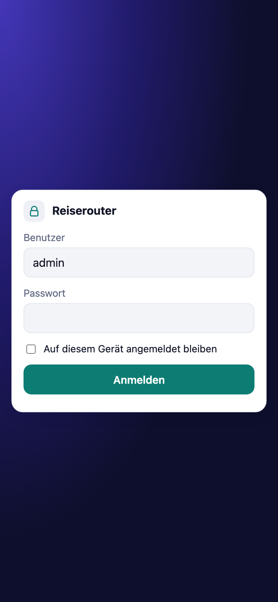 |  | 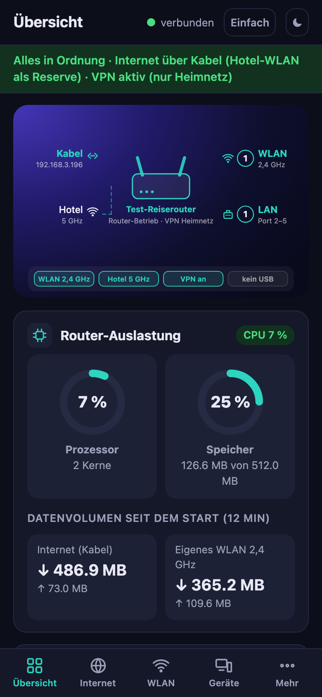 |
| **Internet** | **Hotel-Anmeldung** | **WLAN** |
| 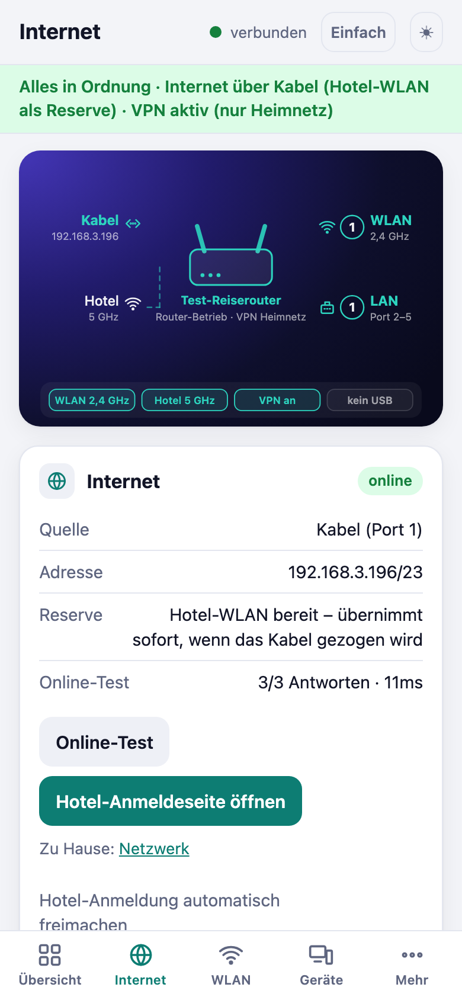 | 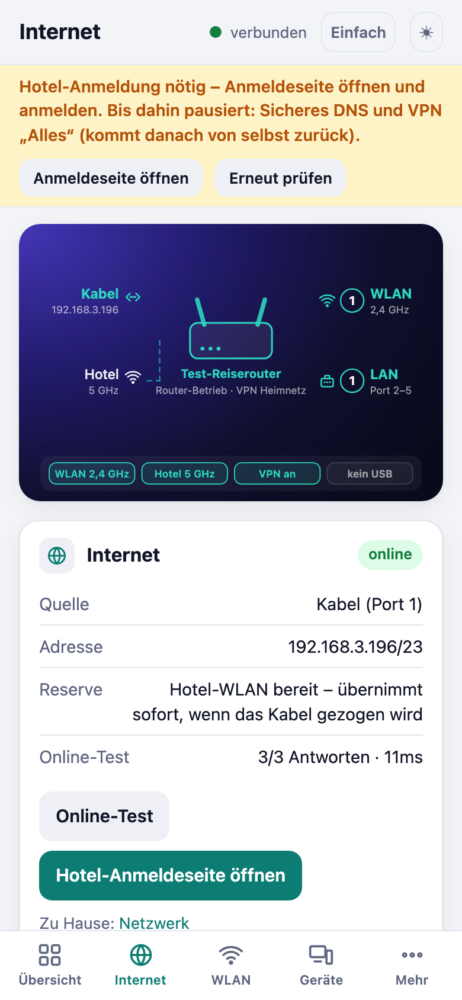 | 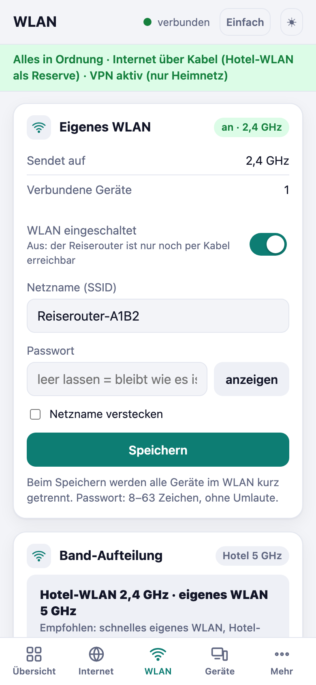 |
| **Geräte** | **Leistung** | **Netzwerk** |
| 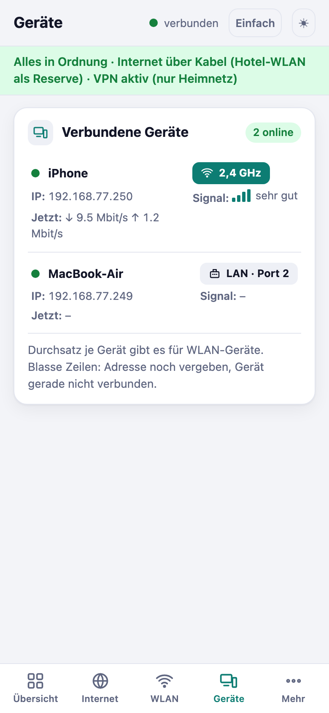 | 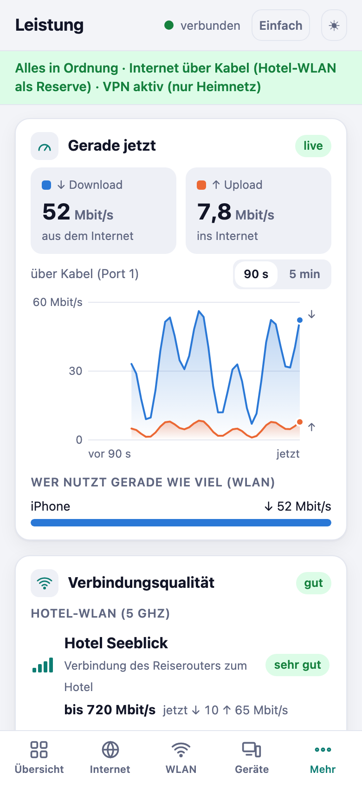 | 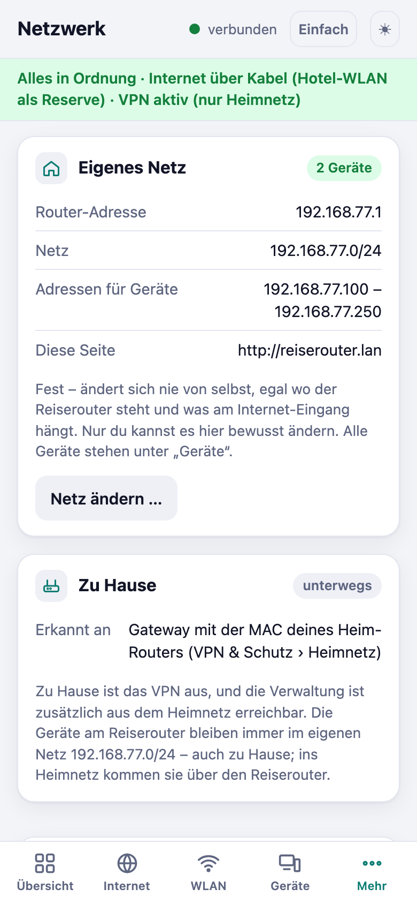 |
| **VPN-Profile** | **Werbeblocker** | **Ersteinrichtung** |
|  |  |  |

**Desktop**

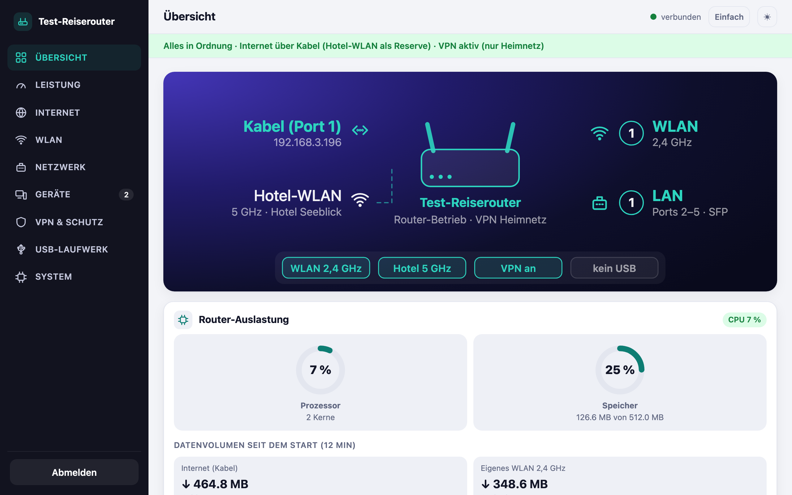

## Wie es funktioniert

- Die Installer-Datei schreibt beim `/import` alle Reiserouter-Skripte, die Grundkonfiguration, die Handy-Seite und
  das Seitenprogramm (gepackt in Stücken) unter `reiseapp/` und startet dann den Ablauf. Jede Stufe übersteht einen
  Neustart.
- Die Handy-Seite läuft als Container aus dem offiziellen `busybox` (Docker Hub, rund 2 MB). Beim ersten Start setzt
  er Seitenprogramm und Seite aus den Stücken zusammen, danach werden die Stücke gelöscht.
- Aus dem Internet lädt der Router nur MikroTik-Pakete (download.mikrotik.com) und busybox.
- Bei hAP ax², ax³ und ac³ benennt der Installer die Funkteile um: `wifi1` ist immer 2,4 GHz (eigenes WLAN),
  `wifi2` immer 5 GHz (Hotel-WLAN). Beim hAP ac³ tauscht er den Treiber `wireless` gegen `wifi-qcom-ac`.

## Teststand (25.11.2026)

Der ganze Ablauf ist in RouterOS-CHR 7.24.6 (arm64, virtuelle Maschine) durchgelaufen: Installation, Handy-Seite,
Anmeldung, Assistent, VPN-Profile, Passwortwechsel. Die Einrichtung entspricht einem hAP ax S im Alltagsbetrieb.
**Auf echter Hardware noch nicht installiert:** der WLAN-Teil (Umbenennen der Funkteile, eigenes WLAN, Hotel-WLAN)
und beim hAP ac³ der Treibertausch.
