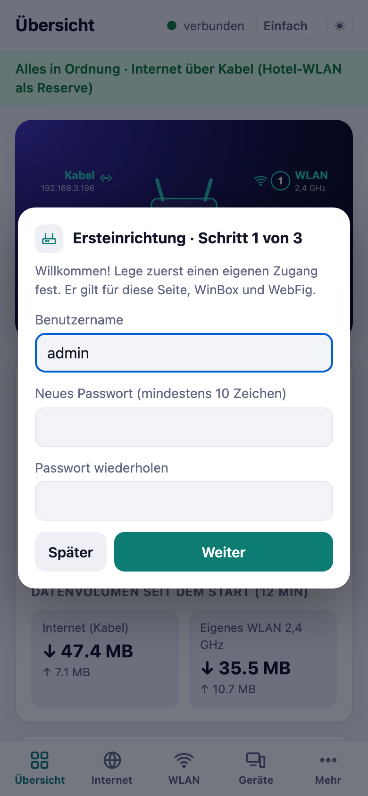
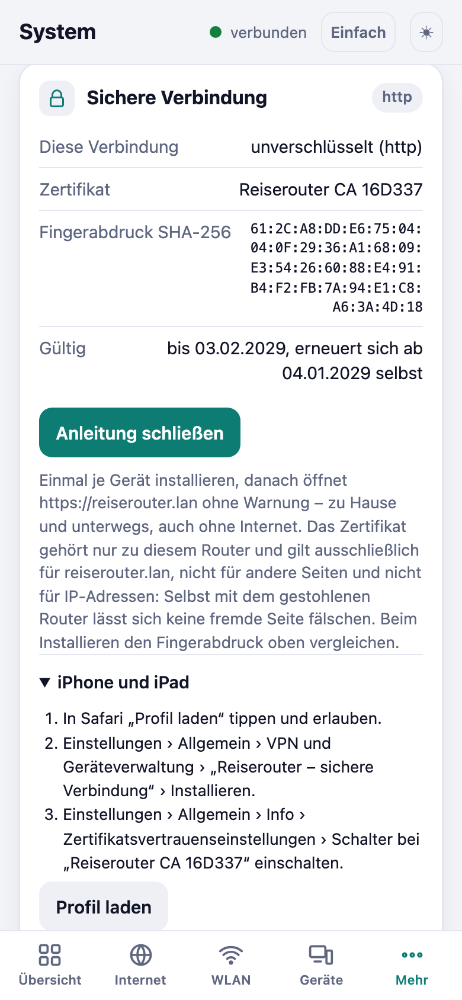

# Reiserouter auf MikroTik hAP ac³

Diese Datei macht aus einem hAP ac³ einen Reiserouter: Handy-Seite zum Bedienen, eigenes WLAN, Hotel-WLAN,
VPN nach Hause per Import (mehrere Profile), Werbeblocker. Sie enthält **keine persönlichen Einstellungen** – Zugang,
WLAN, VPN und Werbeblocker legst du danach im Assistenten der Handy-Seite fest.

**Datei:** `reiserouter-install-hap-ac3.rsc.zip` in diesem Ordner. Entpacken – auf den Router kommt die enthaltene
`reiserouter-install-hap-ac3.rsc` (rund 3,8 MB, Prozessor arm). Sie läuft auch auf dem hAP ax S (gleicher
Prozessor), das Modell erkennt der Installer selbst.

> **Achtung:** Der Installer setzt das Gerät zurück. Nur auf einem neuen Gerät verwenden oder auf einem, dessen
> Einstellungen weg dürfen.

## Du brauchst
- den hAP ac³ mit Netzteil
- einen Laptop mit WinBox (oder einem Browser) und ein LAN-Kabel
- ein Kabel mit Internet für Port 1, z. B. vom Router zu Hause. Darüber lädt der Router die MikroTik-Pakete und das
  offizielle busybox (rund 2 MB) für die Handy-Seite.
- rund 15 Minuten

## 1. Vorbereiten
1. Internet-Kabel an **Port 1**, Laptop an **Port 2**, Strom an.
2. WinBox öffnen und den Router unter **192.168.88.1** verbinden (oder in „Neighbors“ über die MAC-Adresse).
   Benutzer `admin`, Passwort vom Aufkleber am Gerät (ältere Geräte: leer). Fragt RouterOS nach einem neuen Passwort,
   irgendeins vergeben – der Installer setzt den Zugang später ohnehin auf admin/admin.
3. RouterOS aktualisieren: **System › Packages › Check For Updates**, Kanal **long-term**, **Download & Install**. Der
   Router startet neu. Nötig ist mindestens RouterOS 7.19 (erprobt mit 7.24.6).
   **Läuft noch RouterOS 6** (ältere hAP ac³): zuerst mit Kanal **upgrade** auf RouterOS 7, danach mit **long-term** auf den aktuellen Stand.

## 2. Installieren
1. `reiserouter-install-hap-ac3.rsc.zip` entpacken und die `reiserouter-install-hap-ac3.rsc` in WinBox › **Files**
   ziehen (im Browser: WebFig › Files › Upload).
2. WinBox › **New Terminal** öffnen und eingeben:
   ```
   /import reiserouter-install-hap-ac3.rsc
   ```
   Der Router schreibt seine Dateien (ein paar Minuten, Terminal offen lassen), prüft Modell und RouterOS-Version,
   lädt die Pakete `container` und `wifi-qcom-ac`, entfernt `wireless` und startet neu.
3. WinBox wieder verbinden (weiter 192.168.88.1) und **Log** öffnen. Kurz nach dem Start steht dort
   `Reise-Installer: BITTE JETZT innerhalb von 5 Minuten am Geraet die Reset-Taste kurz druecken …`.
   Dann **innerhalb von 5 Minuten die Reset-Taste kurz drücken (nicht halten) oder den Strom kurz trennen.** Damit
   erlaubst du RouterOS den Container für die Handy-Seite. Der Router startet neu.
4. Jetzt setzt er sich selbst ohne Vorgaben zurück und richtet den Reiserouter ein (3–5 Minuten). WinBox verliert dabei
   die Verbindung, die Adresse 192.168.88.1 gibt es danach nicht mehr.

## 3. Erster Start
1. Laptop-Kabel kurz ab- und wieder anstecken (neue Adresse 192.168.77.x) **oder** ins WLAN **Reiserouter-XXXX**
   (XXXX = Ende der MAC-Adresse), Passwort **admin1234**.
2. Browser: **http://192.168.77.1**, Anmeldung **admin / admin**.
3. Der Assistent führt durch drei Schritte:
   1. eigener Benutzer und Passwort (gilt auch für WinBox)
   2. Gerätename und WLAN (Name, Passwort, Land)
   3. optional VPN nach Hause (WireGuard-Datei, z. B. aus UniFi; mehrere Profile mit Umschalter) und die
      FAH-Adblock-Datei

   Alles geht auch später auf der Handy-Seite unter „VPN & Schutz“.

   

WinBox erreicht den Router danach unter **192.168.77.1**, WebFig unter **http://192.168.77.1:8080**.

## Sichere Verbindung (https)
Die Handy-Seite gibt es auch verschlüsselt unter **https://reiserouter.lan**. Jeder Router erzeugt dafür beim ersten Start
seine **eigene Zertifizierungsstelle (CA)**. Sie gilt nur für reiserouter.lan, nicht für andere Seiten und nicht für
IP-Adressen. Selbst wer den Router stiehlt, kann damit keine fremde Seite fälschen.

1. Handy-Seite öffnen › **System › Sichere Verbindung › Zertifikat installieren**.
2. Das eigene System aufklappen und den Schritten folgen:
   - **iPhone/iPad:** Profil in Safari laden › Einstellungen › Allgemein › VPN und Geräteverwaltung › Installieren ›
     danach Einstellungen › Allgemein › Info › **Zertifikatsvertrauenseinstellungen** › Schalter einschalten.
   - **Mac:** Profil laden › Systemeinstellungen › Allgemein › Geräteverwaltung › Profil installieren. **Danach unbedingt:**
     Schlüsselbundverwaltung (⌘-Leertaste) › Anmeldung › Zertifikate › „Reiserouter CA …“ doppelklicken › Vertrauen ›
     „SSL (Secure Sockets Layer)“: „Immer vertrauen“, mit dem Mac-Passwort bestätigen. macOS gibt einem selbst installierten
     Profil kein Vertrauen für https – ohne diesen Schritt öffnen nur Chrome und Brave die Seite ohne Warnung, Safari nicht.
   - **Android:** `.crt` laden › Einstellungen › Sicherheit › Verschlüsselung und Anmeldedaten › CA-Zertifikat installieren.
   - **Windows:** `.crt` öffnen › Zertifikat installieren › Lokaler Computer › Vertrauenswürdige Stammzertifizierungsstellen.
3. Den Fingerabdruck auf der Seite mit dem auf dem Gerät vergleichen.

Das ist einmal je Gerät nötig, danach nie wieder: Der Router erneuert sein Zertifikat selbst. http://reiserouter.lan
bleibt immer erreichbar (Gäste, erste Einrichtung). Auf http zeigt die Seite einen dezenten Hinweis „Sichere Seite
öffnen“, sobald das Gerät die CA kennt.



## Was eingerichtet ist
- **Ports:** Port 1 = Internet (Kabel). Port 2–5 = eigenes Netz.
- **Funk:** Der Installer tauscht den WLAN-Treiber: Paket `wifi-qcom-ac` statt `wireless`. Danach steht das WLAN in WinBox unter **WiFi**, die Menüs Wireless und CAPsMAN gibt es nicht mehr. Die Funkteile benennt er so, dass `wifi1` = 2,4 GHz und `wifi2` = 5 GHz ist. Das eigene WLAN läuft auf 2,4 GHz. Das 5-GHz-Funkteil verbindet sich bei Bedarf mit einem
  Hotel-WLAN, das du auf der Handy-Seite auswählst.
- **Eigenes Netz** 192.168.77.0/24: Router 192.168.77.1, Geräte bekommen .100–.250, Name `reiserouter.lan`.
- **Sicheres DNS** (Cloudflare über HTTPS) und die Werbeblocker-Liste StevenBlack.
- **Handy-Seite** auf Port 80 (http) und 443 (https), als Container `reiseapp` aus dem offiziellen busybox.
- **Router-Log ohne Werte:** Einstellungsänderungen stehen ohne ihren Inhalt im Log, damit VPN-Schlüssel und die
  FAH-Adblock-Adresse dort nicht auftauchen. Anmeldungen stehen weiter im Log.

## Wenn etwas hakt
Fortschritt und Fehler zeigt im Terminal `/log print where message~"Reise-Installer"`.

| Meldung | Was tun |
| --- | --- |
| `Diese Datei ist fuer … (Prozessor …)` | Falsche Datei, es wurde nichts geändert. Die Datei aus dem Ordner des Geräts nehmen. |
| `Modell … wird nicht unterstuetzt` | Es gehen nur hAP ax S, ax², ax³ und ac³. Der hAP ac² hat zu wenig Speicher. |
| `RouterOS … ist zu alt` | Wie in Schritt 1.3 aktualisieren, dann die Datei erneut importieren. |
| `Paket … nicht ladbar` | Port 1 hat kein Internet. Kabel prüfen, dann im Terminal `/import reiseapp/install.rsc`. |
| Reset-Taste verpasst, der Router startet nicht neu | Im Terminal `/import reiseapp/install.rsc` eingeben oder den Strom aus- und wieder einschalten. Die Bitte steht dann erneut im Log. |
| `Kein Internet an Port 1 - busybox …` | Die Handy-Seite kommt von selbst, sobald Port 1 Internet hat. |
| https://reiserouter.lan warnt | Das Gerät kennt die CA noch nicht (siehe „Sichere Verbindung“) oder fragt per IP – https gilt nur für den Namen reiserouter.lan. |
| Seite nach 10 Minuten nicht da | WinBox auf 192.168.77.1 (admin/admin) und das Log wie oben ansehen. |

## Noch mal von vorn (nicht erprobt)
1. Werkszustand: Strom trennen, Reset-Taste gedrückt halten, Strom an, loslassen, sobald die LED blinkt.
2. WinBox auf 192.168.88.1, in **Files** den Ordner `reiseapp` löschen.
3. Ab Schritt 2 wie oben. Pakete und Container-Erlaubnis bleiben erhalten, die Reset-Taste ist dann nicht noch einmal
   nötig.

## Teststand (25.11.2026)
Noch nicht auf einem echten hAP ac³ erprobt, auch der Treibertausch nicht. Der Ablauf lief vollständig in der Test-VM (RouterOS-CHR, Prozessor arm64), dort gibt es aber kein WLAN.

---
Bauzeit und Prozessor stehen in der ersten Zeile der `.rsc`-Datei. Bilder der Handy-Seite: [`../bilder`](../bilder/).
